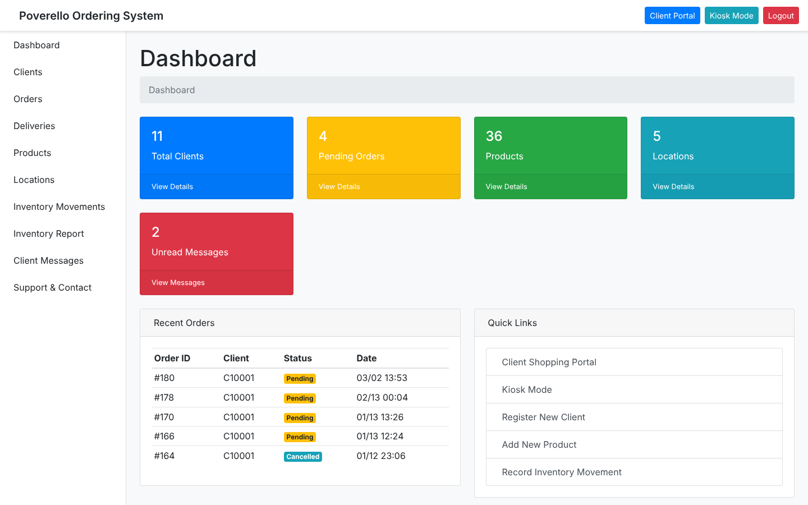
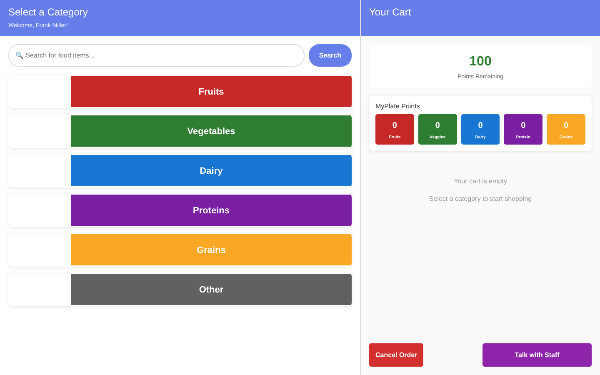
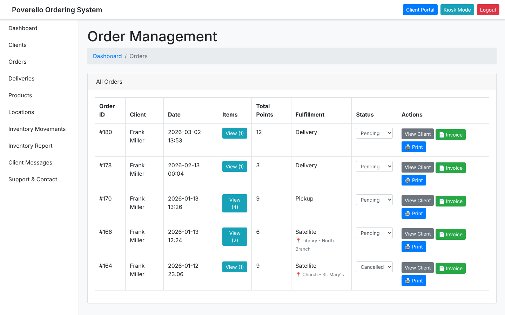
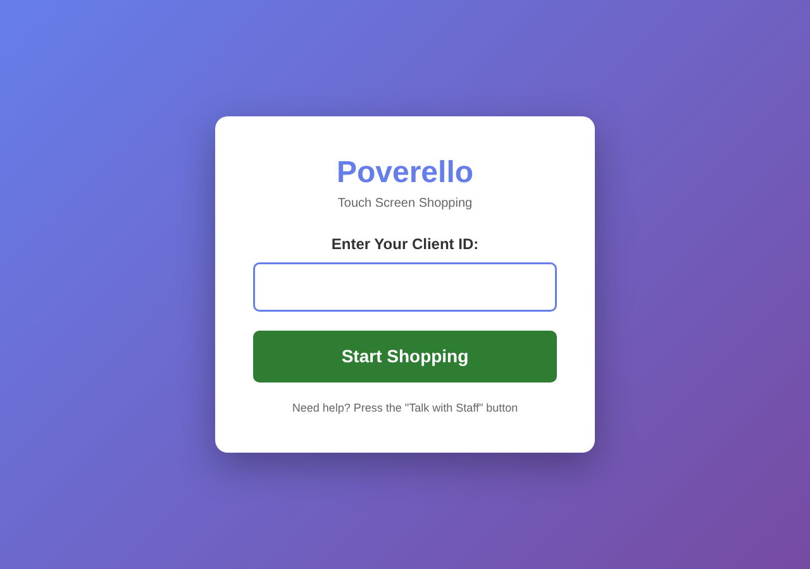

# Poverello Pantry

An ordering and inventory system we built for the Poverello food pantry. Clients shop for groceries with points instead of money, either on their own device or at a touch-screen kiosk in the pantry, and staff manage products, inventory, orders, and deliveries from one dashboard.



[Explore the public demo](https://poverello.vercel.app)

**Public demo vs. live system:** the operational app is deployed separately and requires authentication. The public demo lets visitors explore the interface without access to that deployment. This is a team project, not a claim of sole authorship.

## What it does

**For clients**
- Shop by MyPlate category (fruits, vegetables, dairy, proteins, grains) with a points budget set for each client.
- Filter by diet (vegan, vegetarian, gluten-free, dairy-free, low sodium, sugar-free). Allergen checks catch items that conflict with what's on the client's profile.
- See a nutrition score for each item, with suggestions for healthier swaps.
- Choose pickup, curbside, delivery, a locker, or a satellite location.
- Message staff from inside the app.



**For staff**
- Manage products, storage locations, and inventory movements between them.
- Track orders and deliveries, update their status, and print invoices.
- Add clients one at a time or in bulk from a CSV.
- Run inventory and revenue reports.



**Kiosk mode.** A large-button version of the shop for the touch screen in the pantry. Clients sign in with their client ID and check out without staff help.



## Tech stack

Python, Flask, SQLAlchemy, SQLite, and Bootstrap (MDB).

## Running it locally

```bash
git clone https://github.com/Andrey199123/Storefront.git
cd Storefront
python3 -m venv .venv
source .venv/bin/activate
pip install -r requirements.txt
cp .env.example .env    # then set SECRET_KEY
python3 setup_sample_data_sql.py
python3 add_inventory.py
python3 main.py
```

Then open:
- Staff dashboard: http://127.0.0.1:5000/
- Client shop: http://127.0.0.1:5000/shop
- Kiosk: http://127.0.0.1:5000/kiosk

The sample data includes test clients `C10001` and `C10002`. Demo mode (`DEMO_MODE` in `main.py`) skips staff login. Use synthetic records only. Before any operational deployment, disable demo mode, replace development credentials, set a strong secret, and review authentication, authorization, and database handling. This public demo configuration is not production-ready.

`backup_database.py` backs up the database and product images. See [BACKUP_INSTRUCTIONS.md](BACKUP_INSTRUCTIONS.md).

## License

[MIT](LICENSE)
